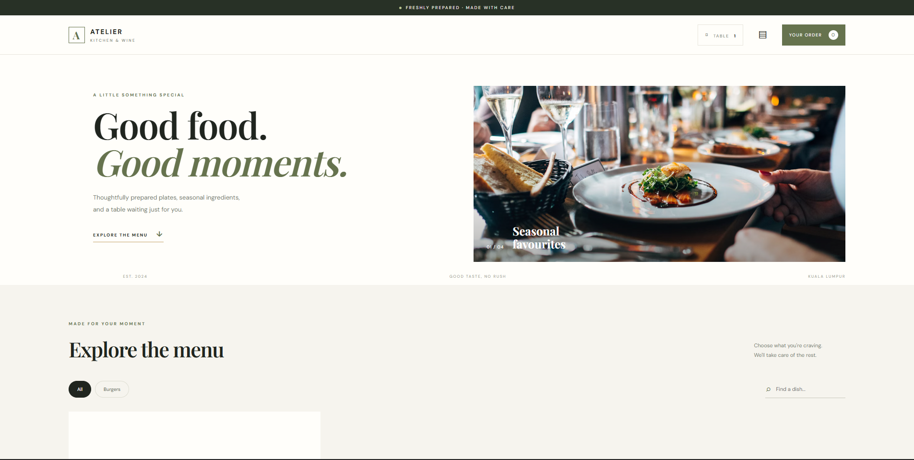
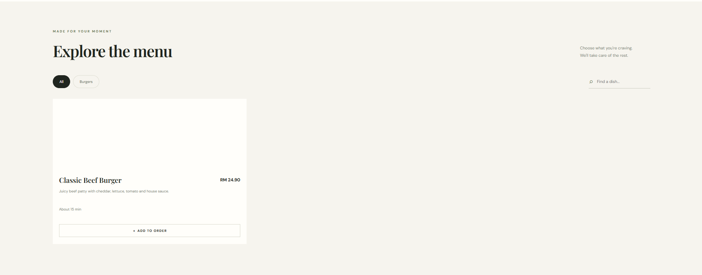
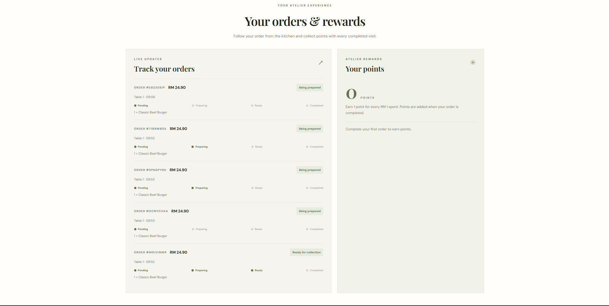
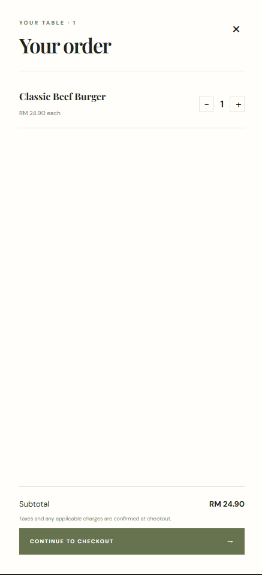
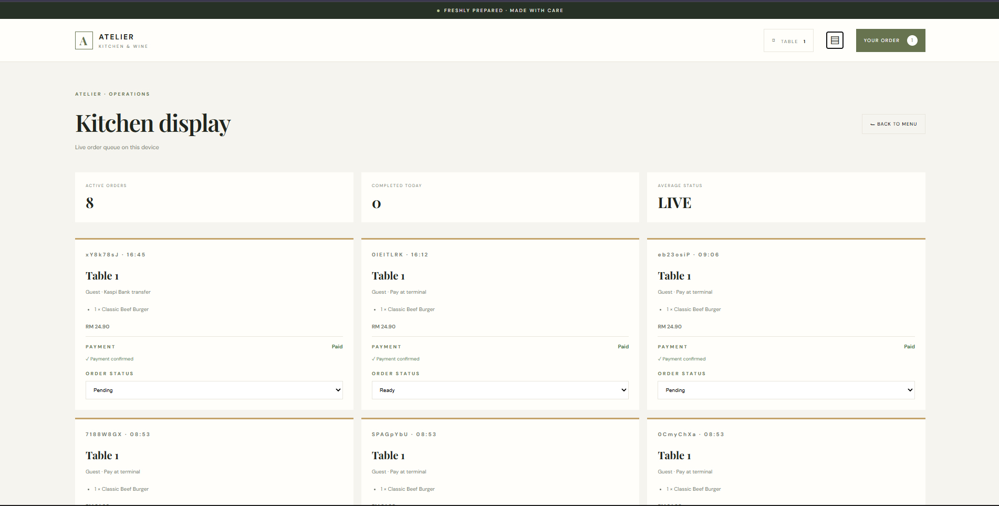

# Atelier — Restaurant Ordering System

A modern digital restaurant ordering system designed to simplify the dining experience for customers and restaurant staff.

Atelier combines an interactive digital menu, real-time order management, kitchen operations, and a customer loyalty program in one application.

## Features

### Customer Experience
- Interactive digital restaurant menu
- Menu categories and product search
- Shopping cart and order placement
- Table-based ordering
- Real-time order status tracking
- Customer loyalty points

### Kitchen Display
- Live order queue powered by Firebase
- Real-time order updates
- Order status management:
  - Pending
  - Preparing
  - Ready
  - Completed
- Payment status management

### Loyalty System
- Automatic points calculation
- 1 loyalty point for every full RM spent
- Automatic creation of customer loyalty records
- Protection against duplicate points for the same order

## Technologies Used

- HTML5
- CSS3
- JavaScript (Vanilla JS)
- Firebase Authentication
- Cloud Firestore

## Project Structure

```text
atelier/
├── index.html
├── styles.css
├── app.js
├── firebase-config.js
├── firestore.rules
├── README.md
└── .gitignore
```

## Getting Started

### 1. Clone the repository

```bash
git clone https://github.com/geroi2017/atelier.git
```

### 2. Open the project

```bash
cd atelier
```

### 3. Configure Firebase

Create or use a Firebase project and configure the Firebase Web SDK settings in `firebase-config.js`.

Enable:
- Firebase Authentication
- Cloud Firestore

### 4. Configure Firestore

Apply the security rules from `firestore.rules` in Firebase Console.

Create and configure the required restaurant, menu, table, and staff documents.

The required Firestore indexes must also be enabled.

### 5. Run locally

Start a local development server:

```bash
python -m http.server 5500
```

Open:

```text
http://localhost:5500
```

## Demo Limitations

- Online payment is currently simulated.
- Payment processing is not connected to a real payment provider.
- Loyalty points are implemented as a prototype and require additional server-side protection before production deployment.
- Customer accounts currently use Firebase anonymous authentication.

## Future Improvements

- Restaurant analytics dashboard
- QR code generation for restaurant tables
- Menu availability management
- Loyalty rewards redemption
- Real payment gateway integration

## Author

**[geroi2017](https://github.com/geroi2017)**

Project creator and developer of Atelier.

Designed and developed the restaurant ordering system, including the customer interface, kitchen management system, Firebase integration, and loyalty program.

# ATELIER — Restaurant Ordering System

<p align="center">
  <strong>A modern digital restaurant experience.</strong><br>
  Online ordering · Kitchen management · Real-time tracking · Customer loyalty
</p>

<p align="center">
  
  
  
  
</p>

## Overview

**Atelier** is a web-based restaurant ordering system designed to improve the dining experience for customers and simplify order management for restaurant staff.

The platform connects a customer-facing digital menu with a real-time kitchen display and a loyalty points system.

The project was built using HTML, CSS, Vanilla JavaScript and Firebase.

## Screenshots

Add your project screenshots to the `screenshots/` folder.

### Customer Interface


### Menu and Food Selection


### Order Tracking and Loyalty


### Kitchen Display


## Key Features

### Customer Experience
- Interactive digital restaurant menu.
- Menu categories and food search.
- Shopping cart and order placement.
- Table-based ordering.
- Real-time order tracking.
- Customer loyalty points.

### Kitchen Display System
- Live order queue.
- Real-time updates using Cloud Firestore.
- Order status management:
  - Pending
  - Preparing
  - Ready
  - Completed
- Payment status management.

### Loyalty Program
- Automatic loyalty points calculation.
- 1 point for every full RM spent.
- Automatic creation of customer loyalty records.
- Protection against duplicate point awards for completed orders.

### Security and Database
- Firebase Authentication.
- Cloud Firestore database.
- Firestore Security Rules.
- Staff access restrictions.
- Transaction-based order completion and loyalty updates.

## System Architecture

```text
          CUSTOMER INTERFACE
                  |
                  v
          VANILLA JAVASCRIPT
                  |
          FIREBASE SERVICES
                  |
          +-------+-------+
          |               |
          v               v
   AUTHENTICATION     CLOUD FIRESTORE
                          |
              +-----------+-----------+
              |           |           |
              v           v           v
          CUSTOMER     KITCHEN      LOYALTY
          TRACKING     DISPLAY      SYSTEM
```

## Technologies Used

| Technology | Purpose |
|---|---|
| HTML5 | Application structure |
| CSS3 | Styling and responsive layout |
| Vanilla JavaScript | Application logic |
| Firebase Authentication | User authentication |
| Cloud Firestore | Database and real-time updates |
| Firestore Security Rules | Database access control |

## Project Structure

```text
atelier/
├── index.html
├── styles.css
├── app.js
├── firebase-config.js
├── firestore.rules
├── README.md
├── .gitignore
└── screenshots/
```

## Getting Started

### Prerequisites
- A modern web browser.
- Python 3 or another local development server.
- A Firebase project.

### Installation

Clone the repository:

```bash
git clone https://github.com/geroi2017/atelier.git
```

Navigate to the project folder:

```bash
cd atelier
```

### Firebase Configuration

Configure your Firebase Web App settings in `firebase-config.js`.

Enable:
- Firebase Authentication.
- Cloud Firestore.

Apply the security rules from `firestore.rules` through the Firebase Console.

Configure the required Firestore collections, documents and composite indexes.

### Run Locally

Start a local development server:

```bash
python -m http.server 5500
```

Open:

```text
http://localhost:5500
```

## Demo Limitations

- Online payment is simulated; no real payment gateway is connected.
- Customer authentication currently supports anonymous accounts.
- The loyalty system is a prototype and requires additional server-side protections before production deployment.
- This project is intended as a demonstration and portfolio application, not a production-ready restaurant platform.

## Future Improvements

- Restaurant administration and analytics dashboard.
- QR code generation for restaurant tables.
- Menu availability management.
- Loyalty rewards redemption.
- Real payment gateway integration.
- Improved customer account management.

## Author

**[geroi2017](https://github.com/geroi2017)**

Project creator and developer of Atelier.

Designed and developed the customer interface, kitchen management system, Firebase integration, real-time order tracking and loyalty program.

---

<p align="center">
  <strong>ATELIER — Kitchen & Wine</strong><br>
  Crafted for good moments.
</p>

## Screenshots

### Customer Homepage


### Menu and Food Selection


### Customer Orders and Loyalty


### Shopping Cart


### Kitchen Display
